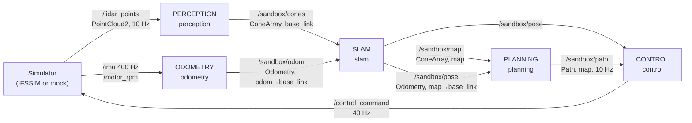

# The pipeline, end to end

This page explains how the sandbox pipeline works as a system. Read it
once before starting the [levels](LEVELS.md), and come back whenever
something downstream behaves strangely.

## The loop



It's a **closed loop**. What control does changes where the car is,
which changes what the LiDAR sees next, and so on. A mistake in any
stage doesn't stay there: it travels downstream and comes back around
as a car in the wrong place.

Each arrow is a ROS topic. Each box is a separate process (node), and
they only talk through those topics. That's why you can replace one box
without touching the others, as long as you keep its inputs and outputs:
the [topic contract](TOPICS.md).

## The frames you need to keep in your head

```
        map (fixed to the world)                base_link (fixed to the car)
         y                                            y (left)
         ▲                                            ▲
         │      🚗 ← pose = (x, y, yaw)                │
         │                                            │
         └──────► x                                   🚗────► x (forward)
```

- **`map`**: the world. The cone map, the pose and the path live here.
  It's identical to the simulator's world frame.
- **`base_link`**: the car. x forward, y left, z up. Detections live here,
  because perception only knows where a cone is *relative to the car*.
  On `/control_command`, positive steering turns **right** (towards −y),
  as on the car. Pure Pursuit gives + = left, so flip the sign when you
  publish, like the baseline does.
- **`odom`**: where **odometry** thinks the car is. It starts exactly on the
  `map` frame (at the start line), but odometry drifts, so the longer
  you drive the further `odom` slides away from the truth.
- **`hesai_lidar`**: the LiDAR. In the sim it has the same orientation as
  `base_link` and sits **1.10 m above the ground**. Where z = 0 is depends
  on the source: on the mock the ground is at z ≈ −1.10 (z from the
  sensor), on IFSSIM at z ≈ 0 (z from the car). Find the ground in the
  scan instead of assuming a height.

The transforms (TF) between them form a chain, the standard ROS one and
the same as on the real car:

```
map ──(SLAM: correction)──► odom ──(odometry: smooth, drifts)──► base_link ──► hesai_lidar
```

Odometry publishes `odom → base_link` (fast, smooth, wrong in the long
run). SLAM publishes `map → odom`, the correction that makes it right
again, plus the pose (`map → base_link`) that planning and control use. That
pose turns "cone 5 m ahead of me" into "cone at (31.2, 58.7)". Helpers
in `sandbox_tools.geometry`: `world_to_body()`, `body_to_world()`.

## Time

- The simulator publishes its own clock on `/clock`, and all nodes run with
  `use_sim_time`. The sim clock can run slower than your wall clock (IFSSIM
  runs at ~0.77×), and nothing breaks.
- Every message carries `header.stamp` = **when the measurement was taken**,
  not when it was processed. Keep the stamp of your input when you publish
  an output (perception publishes cones with the stamp of the scan).
- Why this matters: SLAM gets the cones of a scan taken, say, 30 ms ago.
  At 10 m/s the car has moved 30 cm since then. The baseline SLAM keeps a
  pose history and looks up **the pose at the scan's stamp** (`pose_at()`).
  Use the latest pose instead and the map smears. Try it!
- Every stage adds delay: scan → cones → map → path → command. Control
  reacts to a world that is already some tens of ms old. The faster the
  car goes, the more this hurts. Perception logs its processing time per
  scan for this reason. The scan period is 100 ms: go over that and scans
  start queueing.

## The stages

### Odometry: `sandbox_pipeline/odometry_baseline.py`

**Job:** estimate how the car moved since the start, from its own sensors
only: wheel speed (`/motor_rpm`) and the IMU, fast (100 Hz) and smoothly.

**Baseline:** dead reckoning. Speed from the motor RPM, heading from
integrating the gyro's yaw rate (minus its bias, measured while the car
stands still at the start). It reads ground truth once, for the start pose
("the car knows it's on the start line").

**Weak spots:** every error is integrated forever: a wrong speed factor,
wheel slip, gyro bias, a missed IMU message. No filtering, no lateral
velocity, no use of the steering angle.

**When it's bad, downstream sees:** a pose that slowly slides away, a map
that smears or doubles (cones placed with a wrong pose), and planning
and control following a track that isn't where the car thinks it is.

**Real pipeline:** `odometry_filter` (C++ EKF: IMU prediction, motor RPM +
steering corrections).

### Perception: `sandbox_pipeline/perception_baseline.py`

**Job:** find cones in each LiDAR scan and say where they are (car frame)
and what colour they are.

**Baseline:** crop → drop ground points (flat ground, height found in each scan)
→ cluster the rest on a 2D grid → keep cone-sized clusters → colour by
brightness (yellow reflects more than blue), big orange by height.

**Weak spots:** flat-ground assumption, fixed thresholds, misses far cones
(few points), colour fails when only one colour is in view, nothing is
tracked between scans.

**When it's bad, downstream sees:** cones missing (holes in the map), ghost
cones (planner swerves), wrong colours (planner pairs the wrong cones and
cuts corners).

**Real pipeline:** `cone_detection`: RANSAC ground plane, DBSCAN
clustering, cone template fit, Numba for speed. No colour: its SLAM and
planner don't need it. Run it here with `sb-launch perception:=ifs09`.

### SLAM: `sandbox_pipeline/slam_baseline.py`

**Job:** answer two questions. *Where am I, really?* (localisation:
correct the odometry drift → `map → odom` and `/sandbox/pose`) and *where
are the cones?* (mapping → `/sandbox/map`). They depend on each other: you
need the pose to place cones in the map, and the map (cones seen again) is
the best way to correct the pose.

**Baseline:**
- pose: **trusts the odometry completely** (`map → odom` stays at identity),
  so the pose *is* the odometry, drift included. Nothing corrects it: that's
  what real SLAM adds. (`pose_source: gt` copies the ground truth instead,
  useful to work on mapping alone.)
- map: transform each detection to `map` with the pose at the scan's time,
  match it to the nearest known cone (< 1 m → same cone, average the
  position), otherwise add a new one. Publish cones seen ≥ 2 times.

**Weak spots:** the cones never correct the pose, so any odometry drift
goes straight into the map. One wrong association is never undone, and
there's no outlier rejection.

**When it's bad, downstream sees:** a map that drifts or doubles (two
copies of the same cone a metre apart), a pose that jumps → the
planner's path jumps → control jerks the steering.

**Real pipeline:** `odometry_filter` (EKF on IMU + motor RPM + steering) and
`cone_slam` (GTSAM factor graph where cone observations correct the
pose).

### Planning: `sandbox_pipeline/planning_baseline.py`

**Job:** from the cone map and the pose, produce the path the car should
follow: a list of points in `map`, starting at the car.

**Baseline:** take mapped cones near the car → pair each blue with the
nearest yellow → midpoints → chain them greedily (closest midpoint ahead
that doesn't turn too much).

**Weak spots:** trusts colours blindly, one bad pair bends the path, the
path is jagged, it only sees 20 m ahead, and it knows nothing about speed.

**When it's bad, downstream sees:** zig-zag paths make control oscillate,
short paths make it cut corners, and a path through a cone line hits cones.

**Real pipeline:** `path_planning`: FaSTTUBe planner (cone sorting,
matching, path calculation).

### Control: `sandbox_pipeline/control_baseline.py`

**Job:** turn path + pose into throttle, brake and steering, 40 times a
second.

**Baseline:** two separate controllers.
- *Steering*: Pure Pursuit (onboarding exercise 7): aim at the path point
  `Ld` metres ahead, steer along the arc through it.
- *Speed*: P controller towards one constant speed (5 m/s). It never slows
  down for corners.
- *Safety*: if the path or the pose stops arriving (> 0.5 s old), brake.

**Weak spots:** constant speed, so it's slow on straights and too fast for
hairpins. The two controllers ignore each other. Pure Pursuit cuts corners
at large lookahead and oscillates at small lookahead.

**Real pipeline:** `control`: pure pursuit / Stanley + PI speed control
with a curvature-based speed profile. Unifying steering and speed control
is one of this season's goals for the team.

## Ground truth: your training wheels

The simulator knows the truth, and the sandbox lets you use it to
**isolate** a stage:

| Want to work on... | Use ground truth for | How |
|---|---|---|
| planning or control | perception | `sb-launch perception:=gt` |
| SLAM (without drift) | odometry | `sb-launch odometry:=gt` |
| mapping only | the whole pose | slam baseline with `pose_source: gt` (params file) |
| checking your perception | comparing | `/sandbox/viz/track` shows the real cones (grey) under your detections |
| seeing how robust a stage is | noisy perception | `ros2 param set /gt_cones position_noise 0.2` (also `miss_rate`, `swap_rate`, `unknown_rate`) |

The real car has no ground truth, so the last level is to drive without
it.

## What the sandbox leaves out (on purpose)

Compared to [IFS09-DV-PIPELINE](https://github.com/isc-fs/IFS09-DV-PIPELINE)
the sandbox skips the machinery that makes the real car safe and
manageable:

- **Lifecycle nodes + `mode_manager` + `mission_control`**: on the car,
  nodes are configured/activated in order for each mission (trackdrive,
  skidpad...), driven by the uDV and Mission Control. Here they just start.
- **`sim_supervisor`**: in the real stack, commands go control →
  mission_control → supervisor → sim, mimicking the car's DVPC → uDV
  path. Here control talks to the sim directly.
- **Watchdog, EBS logic, recording services, car/sim launch profiles.**

Once you understand the boxes above, those parts are much easier
to learn on the real pipeline.

## Looking inside a running pipeline

```bash
ros2 node list                         # who's running
ros2 topic list                        # what's being published
ros2 topic hz /sandbox/cones           # how often (is perception keeping up?)
ros2 topic delay /sandbox/path         # how old is it when it arrives
ros2 topic echo /control_command       # what's being sent to the car
ros2 node info /planning               # what a node subscribes / publishes
ros2 param list /control               # its parameters...
ros2 param set /control target_speed 7.0   # ...and change one live
```

In Lichtblick, toggle topics in the 3D panel to compare stages: raw LiDAR
vs detections vs map vs ground truth.
